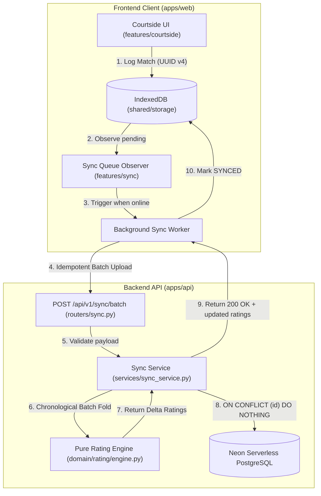

# Research: Frontend and Backend Architectural Methodology

**Issue Reference**: [#6 Research: Frontend and Backend Architectural Methodology (Clean Architecture vs Feature-Sliced)](https://github.com/kidomarcostelo/badminque/issues/6)  
**Parent Specification**: [#12 Spec: Badminque MVP Implementation](https://github.com/kidomarcostelo/badminque/issues/12)  
**Status**: Recommendation & Technical Specification  
**Date**: 2026-10-22  
**Target Repository Seams**: `apps/web`, `apps/api`, `packages/core`

---

## 1. Executive Summary & Architectural Decision

Before implementing the core domain tickets ([#14](https://github.com/kidomarcostelo/badminque/issues/14) Rating Engine through [#20](https://github.com/kidomarcostelo/badminque/issues/20) Player Passport), this research evaluates the candidate architectural methodologies for **Badminque** across both frontend (Next.js PWA) and backend (Python FastAPI).

### 1.1 Evaluated Methodologies

| Dimension | Option A: Full Formalism | Option B: Naive Layered | Option C: Recommended Architecture |
| :--- | :--- | :--- | :--- |
| **Frontend (`apps/web`)** | **Full Feature-Sliced Design (FSD)**<br>6 strict layers: `app`, `pages`, `widgets`, `features`, `entities`, `shared`. | **Traditional Flat Layered**<br>`components/`, `hooks/`, `services/`, `pages/`. | **Feature-Driven Vertical Slices (FDVS)**<br>Domain-bounded features (`features/<domain>/`) + Monorepo Core (`@badminque/core`) + Thin App Router. |
| **Backend (`apps/api`)** | **Strict Hexagonal / Clean**<br>ABCs for every repo/interactor, triple DTO mapping (SQLAlchemy $\to$ Entity $\to$ Interactor DTO $\to$ Pydantic). | **Naive Flat Layered**<br>Fat routers directly querying SQLAlchemy models and calculating Elo deltas inline. | **Pragmatic Clean Domain Core (Hexagonal-Core)**<br>Zero-dependency pure Python domain math (`domain/rating`, `domain/matching`) + thin async FastAPI routers and transactional services. |

### 1.2 Decision Summary

1. **Frontend (`apps/web`) &rarr; Feature-Driven Vertical Slices (FDVS)**:
   - Full **Feature-Sliced Design (FSD)** is rejected: Its 6-layer hierarchy creates severe folder sprawl, awkward collisions with Next.js App Router's file-system routing conventions, and artificial impedance between `entities` and `features` for a solo developer.
   - Traditional **Flat Layered** is rejected: Leads to the "junk drawer" anti-pattern in `components/` and `hooks/`, causing circular dependencies and tangled imports as courtside queueing complexity grows.
   - **Adopted**: **Feature-Driven Vertical Slices**. Modules are organized strictly around domain concepts from `GLOSSARY.md` (`features/courtside`, `features/queue`, `features/roster`, `features/sync`, `features/passport`). Shared pure primitives reside in `@badminque/core`, and shared UI primitives live in `shared/ui`. Next.js `app/` routes remain thin compositional shells.
2. **Backend (`apps/api`) &rarr; Pragmatic Clean Domain Core (Hexagonal-Core)**:
   - Full **Strict Hexagonal Architecture** is rejected: For an MVP on Neon PostgreSQL with FastAPI, creating Abstract Base Classes, Use Case interactors, and 3-way object mappers for every table incurs a 300% boilerplate penalty that stifles solo-developer velocity.
   - Naive **Flat Layered** is rejected: Blurring rating calculations or queue dispatch directly into FastAPI route handlers or SQLAlchemy models prevents deterministic property-based testing and violates the mathematical rating invariants.
   - **Adopted**: **Pragmatic Clean Domain Core**. The mathematical rating engine (`BadminqueRatingEngine`) and queue dispatch logic are completely decoupled from FastAPI and SQLAlchemy as **pure, synchronous, zero-dependency Python packages** (`badminque_api/domain/rating/` and `domain/matching/`). They accept frozen dataclasses and primitive numbers, returning pure calculation deltas. FastAPI routers and transactional services (`badminque_api/services/`) remain thin orchestration layers.
3. **Locality & Test Invariant Preservation**:
   - Conforms strictly to Rule 1.5 in `CODING_STANDARDS.md`: all unit tests must be colocated with their source files (`*.test.ts`, `test_*.py`). No separate mirror test hierarchies.

---

## 2. Frontend Architecture: Feature-Driven Vertical Slices (FDVS)

### 2.1 The Problem with Full Feature-Sliced Design (FSD) in Next.js App Router

Feature-Sliced Design (FSD) specifies 6 rigid layers:
```
app/ &rarr; pages/ &rarr; widgets/ &rarr; features/ &rarr; entities/ &rarr; shared/
```
While beneficial in massive enterprise monorepos with dozens of engineers, FSD presents distinct anti-patterns for Badminque:
1. **Next.js App Router Incompatibility**: Next.js App Router conflates routing, layout composition, and data fetching inside the `app/` directory. FSD's distinction between `app/`, `pages/`, and `widgets/` requires awkward workarounds (e.g., placing route handlers in `app/` that merely re-export from `pages/`).
2. **Entities vs. Features Ambiguity**: In Badminque, a "Roster Player" is both a core data model (entity) and an active courtside interaction surface (check-in, status toggle, search). In FSD, splitting this across `entities/player/` and `features/player-check-in/` forces developers to constantly jump across 4 levels of directories for a single UI action.
3. **Boilerplate and File Fragmentation**: Every slice requires its own `index.ts`, `ui/`, `model/`, `api/`, and `lib/` sub-directories, generating 15+ files before rendering a single courtside button.

### 2.2 The Problem with Flat Layered Architecture

Traditional flat architecture (`src/components/`, `src/hooks/`, `src/services/`):
- Leads to a massive `components/` dumping ground containing 40+ unrelated files.
- Makes it nearly impossible for an AI agent or solo developer to identify which hook (`useRoster`, `useQueue`, `useStorage`) belongs to which UI flow.
- Invites circular dependencies when a court station component cross-imports from a roster modal.

### 2.3 Selected Methodology: Feature-Driven Vertical Slices (FDVS)

We divide the frontend into three clean tiers:
1. **Monorepo Domain Core (`@badminque/core`)**: Pure TypeScript contracts, interfaces, enums, and domain constants (shared across frontend and future worker tools). Zero React or DOM dependencies.
2. **Feature Slices (`apps/web/src/features/<slice>/`)**: Self-contained vertical slices corresponding directly to Badminque domain capabilities:
   - `courtside`: 3-court station cards, station grid, quick score modal (`SINGLE_30`), rolling dispatch transitions.
   - `queue`: Queue priority $Q(i)$ sorting, on-deck staging list, manual overrides, pair pinning action sheets.
   - `roster`: Rapid courtside player check-in, search/filter, guest player creation with permanent UUIDs.
   - `sync`: IndexedDB batch sync buffer, online/offline status monitors, manual sync trigger button.
   - `passport`: Claim token QR code generation, claim token redemption view, player passport summary.
3. **Shared Foundation (`apps/web/src/shared/`)**: Domain-agnostic UI building blocks (Button, Card, Modal, Badge), storage adapters, and utility helpers.
4. **App Composition (`apps/web/src/app/`)**: Thin Next.js App Router entry points that compose feature slices into viewports.

### 2.4 Target Frontend Directory Tree (`apps/web`)

```text
apps/web/
├── public/
│   ├── manifest.json
│   └── sw.js                           # PWA Service Worker (app shell & cache)
├── src/
│   ├── app/                            # Thin Next.js App Router (Composition only)
│   │   ├── globals.css
│   │   ├── layout.tsx                  # Root HTML/Body shell & meta tags
│   │   ├── layout.test.ts              # Colocated layout test
│   │   ├── page.tsx                    # Courtside Station Board (composes features)
│   │   ├── page.test.tsx               # Colocated dashboard integration test
│   │   └── passport/
│   │       └── [token]/
│   │           ├── page.tsx            # Public Player Passport / Claim view
│   │           └── page.test.tsx       # Colocated passport claim route test
│   ├── features/                       # Vertical Domain Slices
│   │   ├── courtside/
│   │   │   ├── CourtStationCard.tsx    # Single station card (Courts 1-3)
│   │   │   ├── CourtStationCard.test.tsx
│   │   │   ├── CourtStationGrid.tsx    # 3-court grid layout
│   │   │   ├── CourtStationGrid.test.tsx
│   │   │   ├── QuickScoreModal.tsx     # 30-pt presets (30-28, 30-22, etc.)
│   │   │   ├── QuickScoreModal.test.tsx
│   │   │   ├── useCourtStations.ts     # Station state machine & timers
│   │   │   └── useCourtStations.test.ts
│   │   ├── queue/
│   │   │   ├── OnDeckList.tsx          # 2-slot pre-grouped on-deck cards
│   │   │   ├── OnDeckList.test.tsx
│   │   │   ├── CustomMatchModal.tsx    # Slot 3 custom staging builder
│   │   │   ├── CustomMatchModal.test.tsx
│   │   │   ├── PairPinningSheet.tsx    # Locked pair arrival anchoring sheet
│   │   │   ├── PairPinningSheet.test.tsx
│   │   │   ├── useQueueDispatch.ts     # Client queue priority & policy hooks
│   │   │   └── useQueueDispatch.test.ts
│   │   ├── roster/
│   │   │   ├── RosterCheckInList.tsx   # Fast check-in list with search/filter
│   │   │   ├── RosterCheckInList.test.tsx
│   │   │   ├── GuestPlayerModal.tsx    # Unauthenticated guest creation
│   │   │   ├── GuestPlayerModal.test.tsx
│   │   │   ├── PlayerStatusBadge.tsx   # QUEUED, PLAYING, RESTING, SKIPPED
│   │   │   ├── PlayerStatusBadge.test.tsx
│   │   │   ├── useRoster.ts            # Local roster CRUD & check-in state
│   │   │   └── useRoster.test.ts
│   │   ├── sync/
│   │   │   ├── SyncStatusBar.tsx       # Pending sync counter & connectivity dot
│   │   │   ├── SyncStatusBar.test.tsx
│   │   │   ├── useSyncQueue.ts         # Hook observing pending matches in IndexedDB
│   │   │   ├── useSyncQueue.test.ts
│   │   │   ├── syncWorker.ts           # Background sync & network drop retry
│   │   │   └── syncWorker.test.ts
│   │   └── passport/
│   │       ├── ClaimQrModal.tsx        # 48-hr expiring Claim Token QR display
│   │       ├── ClaimQrModal.test.tsx
│   │       ├── PassportCard.tsx        # Player Passport display (R_S, R_D)
│   │       ├── PassportCard.test.tsx
│   │       ├── usePassportClaim.ts     # Claim token verification hook
│   │       └── usePassportClaim.test.ts
│   └── shared/                         # Domain-Agnostic Shared Foundation
│       ├── storage/
│       │   ├── indexedDbClient.ts      # Low-level openDB wrapper & migrations
│       │   ├── indexedDbClient.test.ts
│       │   ├── storageService.ts       # Implementation of StorageAdapter
│       │   └── storageService.test.ts
│       ├── ui/                         # Atomic Reusable UI Components
│       │   ├── Button.tsx
│       │   ├── Button.test.tsx
│       │   ├── Card.tsx
│       │   ├── Card.test.tsx
│       │   ├── Modal.tsx
│       │   ├── Modal.test.tsx
│       │   ├── Badge.tsx
│       │   └── Badge.test.tsx
│       └── lib/
│           ├── dateUtils.ts            # ISO 8601 parsing & elapsed timers
│           └── dateUtils.test.ts
```

### 2.5 Frontend Dependency & Import Rules

To prevent spaghetti coupling while maintaining rapid development:
1. **Unidirectional Import Boundary**:
   $$\text{app/} \implies \text{features/*} \implies \text{shared/*} \implies \text{@badminque/core}$$
2. **Strict Sibling Feature Isolation**:
   - `features/courtside` must **never** import directly from `features/roster` or `features/queue`.
   - When features need to interact (e.g., completing a match in `courtside` marks 4 players `RESTING` in `roster` and updates `queue` wait times), they communicate via:
     - Shared domain contracts in `@badminque/core`.
     - Shared storage state in `shared/storage/storageService.ts`.
     - Composition at the page level in `app/page.tsx` or a shared event callback.
3. **No Direct IndexedDB in Components**:
   - UI components must **never** import `idb` or call `indexedDB` directly. They consume typed custom hooks (`useRoster`, `useCourtStations`, `useSyncQueue`).

---

## 3. Backend Architecture: Pragmatic Clean Domain Core (Hexagonal-Core)

### 3.1 The Problem with Strict Hexagonal Architecture in FastAPI

Strict Hexagonal Architecture enforces:
```
Presentation (Routers) &rarr; Application (Use Cases) &rarr; Ports (Interfaces) &rarr; Domain &larr; Adapters (Repositories, Database)
```
For Badminque MVP, strict hexagonal architecture has several major drawbacks:
1. **Boilerplate Explosion**: Creating an Abstract Base Class (ABC) for `PlayerRepository`, a `PostgreSqlPlayerRepository` adapter, a `CreatePlayerUseCase`, a `PlayerDTO`, an `SQLAlchemyPlayerModel`, and a `PlayerPydanticSchema` for every entity requires 6 files per operation.
2. **Mapping Penalty**: Transforming SQLAlchemy model &rarr; Domain Entity &rarr; DTO &rarr; Pydantic Schema introduces serialization friction with zero architectural gain when PostgreSQL is the singular, committed database.
3. **Impedance with FastAPI Idioms**: FastAPI’s dependency injection (`Annotated[AsyncSession, Depends(get_db_session)]`) is built for concise, composable async handlers. Forcing it through abstract use cases obscures transaction boundaries.

### 3.2 The Problem with Naive Flat Layered FastAPI

Placing all logic in routers or fat SQLAlchemy models:
- Tangles mathematical rating calculations with asynchronous SQLAlchemy ORM sessions.
- Makes running thousands of Hypothesis property-based tests impossible without bootstrapping a database or building heavy mocks.
- Violates Invariant 3 in `AGENTS.md` (Pure mathematical calculation engine).

### 3.3 Selected Methodology: Pragmatic Clean Domain Core (Hexagonal-Core)

We bifurcate the backend into two distinct zones:
1. **The Pure Domain Core (`badminque_api/domain/`)**:
   - Zero framework dependencies: strictly **no FastAPI, no SQLAlchemy, no async I/O**.
   - Pure Python 3.10+ standard library (`math`, `dataclasses`, `uuid`, `enum`).
   - 100% deterministic, synchronous, pure functions and slotted frozen dataclasses (`@dataclass(slots=True, frozen=True)`).
   - Contains:
     - `rating/`: `BadminqueRatingEngine`, logarithmic MOV multiplier, weak-link soft mean, continuous $K$-factor decay, and non-inversion invariants.
     - `matching/`: Priority score calculation $Q(i) = t_{\text{wait}} - 1800 \cdot M_i + 600 \cdot S_i$, and the 4 rotation policies (*Fair Play*, *Split & Mix*, *Court Ladder*, *Flighted Tiers*).
   - Tested using **Hypothesis** property-based tests and parameterized unit tests with sub-millisecond execution and zero mocking.
2. **The Pragmatic Infrastructure & Application Layer (`badminque_api/`)**:
   - **`models/`**: SQLAlchemy 2.0 async declarative models (`club.py`, `player.py`, `match.py`).
   - **`schemas/`**: Pydantic v2 schemas for API validation, serialization, and OpenAPI documentation.
   - **`services/`**: Transactional orchestration services. They manage `AsyncSession` transactions, fetch models, execute pure domain logic in the Domain Core, and commit changes atomically.
   - **`routers/`**: Thin FastAPI route handlers that validate requests, inject database sessions, delegate to services, and return responses.

### 3.4 Target Backend Directory Tree (`apps/api`)

```text
apps/api/
├── alembic/
│   ├── env.py
│   └── versions/
│       └── 20261018_0001_initial_schema.py
├── alembic.ini
├── pyproject.toml
├── src/
│   └── badminque_api/
│       ├── config.py                   # Pydantic BaseSettings (Neon DB URL, CORS)
│       ├── database.py                 # Async SQLAlchemy engine & sessionmaker
│       ├── exceptions.py               # RFC 7807 Problem Details exceptions
│       ├── main.py                     # FastAPI app factory, CORS, exception handlers
│       ├── test_health.py              # Colocated health check test
│       ├── test_migrations.py          # Colocated migration test
│       │
│       ├── domain/                     # 🛡️ PURE DOMAIN CORE (Zero DB / Zero FastAPI)
│       │   ├── rating/
│       │   │   ├── engine.py           # BadminqueRatingEngine (fold_match, fold_batch)
│       │   │   ├── test_engine.py      # Colocated unit tests for rating engine
│       │   │   ├── invariants.py       # Non-inversion invariant assertions
│       │   │   ├── test_invariants.py  # Hypothesis property-based invariant test suite
│       │   │   ├── mov.py              # Logarithmic MOV calculation & damping
│       │   │   ├── test_mov.py         # Colocated MOV test suite
│       │   │   ├── soft_mean.py        # Weak-link soft mean team rating (58/42)
│       │   │   ├── test_soft_mean.py   # Colocated soft mean test suite
│       │   │   ├── k_decay.py          # Continuous K-factor decay formula
│       │   │   └── test_k_decay.py     # Colocated K-decay test suite
│       │   └── matching/
│       │       ├── queue_priority.py   # Q(i) priority score calculation
│       │       ├── test_queue_priority.py
│       │       ├── policies.py         # Fair Play, Split & Mix, Ladder, Flighted
│       │       └── test_policies.py    # Colocated policy test suite
│       │
│       ├── models/                     # 🗄️ PERSISTENCE (SQLAlchemy 2.0 Declarative)
│       │   ├── base.py                 # Base declarative model
│       │   ├── club.py                 # Club & ClubNight models
│       │   ├── player.py               # RosterPlayer & ClaimToken models
│       │   └── match.py                # MatchRecord model with UUID v4 primary keys
│       │
│       ├── schemas/                    # 📋 VALIDATION (Pydantic v2 Request/Response)
│       │   ├── club.py
│       │   ├── health.py
│       │   ├── match.py
│       │   ├── player.py
│       │   ├── sync.py                 # Batch sync payload schemas
│       │   └── test_schemas.py
│       │
│       ├── services/                   # ⚙️ ORCHESTRATION & TRANSACTIONS
│       │   ├── sync_service.py         # Batch sync fold, ON CONFLICT, rating commits
│       │   ├── test_sync_service.py    # Colocated sync service integration test
│       │   ├── roster_service.py       # Player check-in & roster persistence
│       │   ├── test_roster_service.py  # Colocated roster service test
│       │   ├── passport_service.py     # Claim token generation & user binding
│       │   └── test_passport_service.py
│       │
│       └── routers/                    # 🌐 PRESENTATION (Thin FastAPI Endpoints)
│           ├── sync.py                 # POST /api/v1/sync/batch
│           ├── test_sync.py            # Colocated endpoint test
│           ├── players.py              # GET /api/v1/clubs/{id}/players
│           ├── test_players.py         # Colocated endpoint test
│           ├── clubs.py                # GET/POST /api/v1/clubs
│           ├── test_clubs.py           # Colocated endpoint test
│           ├── passport.py             # POST /api/v1/claim/{token}
│           └── test_passport.py        # Colocated endpoint test
```

### 3.5 Backend Dependency & Layer Rules

1. **Domain Isolation Invariant**:
   - `domain/rating/` and `domain/matching/` must **never** import from `badminque_api.models`, `badminque_api.routers`, `badminque_api.database`, `sqlalchemy`, or `fastapi`.
   - The domain core can only import standard library modules.
2. **Thin Routers Invariant**:
   - Routers are strictly for HTTP concerns: unpacking query/path parameters, validating Pydantic schemas, dependency injection of DB session, invoking a service, and mapping to HTTP response codes.
   - Routers must **never** execute raw SQL queries, direct ORM commits, or mathematical rating formulas inline.
3. **Transaction Boundary Locality**:
   - All database write operations occur within explicit async context managers in `services/`:
     ```python
     async with session.begin():
         # Fetch batch -> Call Domain Rating Engine -> Persist -> Commit
     ```

---

## 4. Offline State & Sync Architecture Specification

The interaction between `apps/web` (courtside PWA) and `apps/api` (backend batch sync) operates under the **Tricount Offline Synchronization Model** defined in `docs/research/sync-protocol-spec.md`.



### 4.1 Client-Side Offline Flow
1. **UUID v4 Match Generation**: When a match concludes courtside, the client generates a permanent UUID v4 and writes the record to IndexedDB with `status = "PENDING"`.
2. **Local Roster Updates**: The client optimistically updates local player match counts and resting states immediately.
3. **Background Sync Worker**:
   - Listens for `navigator.onLine` events and Service Worker `sync` events.
   - Pulls pending matches from IndexedDB ordered by `(recorded_at, sequence_num)`.
   - Dispatches `POST /api/v1/sync/batch`.
   - Upon receiving `200 OK`, updates local status to `"SYNCED"` in a single IndexedDB transaction.

### 4.2 Server-Side Idempotent Batch Processing Flow
1. **Idempotency Guarantee**:
   - Match insertions use `ON CONFLICT (id) DO NOTHING`.
   - If a tablet drops offline midway through a sync attempt and retries, the server safely ignores already-inserted match UUIDs.
2. **Chronological Batch Fold**:
   - The backend sorts all newly received matches across the club night chronologically:
     $$\text{sort key} = (\text{recorded\_at}, \text{sequence\_num})$$
   - Matches are passed into `BadminqueRatingEngine.fold_batch()`, which computes rating updates sequentially while honoring weak-link soft mean, non-inversion, and continuous $K$-factor decay.
   - Updates to `roster_players` (`singles_rating`, `doubles_rating`, `matches_played`) and `matches` are committed atomically.

---

## 5. Solo-Developer Velocity & AI Agent Navigation

### 5.1 Cognitive Load Comparison

| Task | Full FSD / Strict Hexagonal | FDVS + Pragmatic Domain Core (Selected) |
| :--- | :--- | :--- |
| **Add a new scoring preset** | Edit 4 layers (`entities/match`, `features/match-scoring`, `widgets/court-station`, `shared/config`) | Edit 2 files: [`@badminque/core/constants.ts`](file:///packages/core/src/constants.ts) and [`QuickScoreModal.tsx`](file:///apps/web/src/features/courtside/QuickScoreModal.tsx) |
| **Tweak weak-link rating gamma** | Edit domain entity, update use case interface, update repository adapter, update test mock | Edit 1 file: [`apps/api/src/badminque_api/domain/rating/soft_mean.py`](file:///apps/api/src/badminque_api/domain/rating/soft_mean.py) and run colocated Hypothesis test |
| **Add courtside player search** | Create `features/search-player`, `entities/player-card`, wire into `widgets/roster-board` | Colocate search input in [`features/roster/RosterCheckInList.tsx`](file:///apps/web/src/features/roster/RosterCheckInList.tsx) |
| **Locate failing test** | Navigate parallel `tests/` tree 5 directory levels deep | Look immediately next to source file in same folder |

### 5.2 Strict Rules of Locality
1. **Rule of Colocation**: Every TypeScript component (`X.tsx`) has its test in `X.test.tsx` in the exact same directory. Every Python module (`y.py`) has its test in `test_y.py` in the exact same directory.
2. **Rule of Monorepo Core**: If an interface or constant is used by both `apps/web` and `apps/api` (or needed across multiple independent web features), it belongs in `@badminque/core`.
3. **Rule of Feature Self-Containment**: A feature folder contains everything needed to render and operate that feature (components, hooks, colocated tests).

---

## 6. Migration & Mapping for MVP Implementation Tickets (#14–#20)

With this architectural methodology ratified, each remaining MVP implementation ticket maps directly to specific target directories:

| Ticket | Title | Target Backend Directory | Target Frontend Directory |
| :--- | :--- | :--- | :--- |
| **[#14](https://github.com/kidomarcostelo/badminque/issues/14)** | **Mathematical Rating Engine & Invariants** | `apps/api/src/badminque_api/domain/rating/` | Pure shared types in `packages/core/src/types.ts` |
| **[#15](https://github.com/kidomarcostelo/badminque/issues/15)** | **Tricount Roster & Offline Check-In** | `apps/api/src/badminque_api/services/roster_service.py` | `apps/web/src/features/roster/` |
| **[#16](https://github.com/kidomarcostelo/badminque/issues/16)** | **3-Court Station Board & Quick Scoring** | N/A (Client-first courtside operation) | `apps/web/src/features/courtside/` |
| **[#17](https://github.com/kidomarcostelo/badminque/issues/17)** | **Queue Dispatch & Matchmaking Engine** | `apps/api/src/badminque_api/domain/matching/` | `apps/web/src/features/queue/` |
| **[#18](https://github.com/kidomarcostelo/badminque/issues/18)** | **Touch-First Overrides & Pair Pinning** | N/A (Client courtside interaction) | `apps/web/src/features/queue/` (Modals & Action Sheets) |
| **[#19](https://github.com/kidomarcostelo/badminque/issues/19)** | **Offline-First Synchronization & Batch Upload** | `apps/api/src/badminque_api/routers/sync.py`<br>`apps/api/src/badminque_api/services/sync_service.py` | `apps/web/src/features/sync/`<br>`apps/web/src/shared/storage/` |
| **[#20](https://github.com/kidomarcostelo/badminque/issues/20)** | **Account Claiming & Player Passport** | `apps/api/src/badminque_api/routers/passport.py`<br>`apps/api/src/badminque_api/services/passport_service.py` | `apps/web/src/features/passport/`<br>`apps/web/src/app/passport/[token]/` |

---

## 7. Next Steps & Execution

1. Commit this specification to `docs/research/architecture-methodology.md`.
2. Update and close Issue [#6](https://github.com/kidomarcostelo/badminque/issues/6) with a reference to the deliverable.
3. Update `TASKS.md` marking [#6](https://github.com/kidomarcostelo/badminque/issues/6) as complete.
4. Proceed immediately to the unblocked frontier ticket: **[#14 Mathematical Rating Engine & Invariant Suite](https://github.com/kidomarcostelo/badminque/issues/14)**, placing all pure rating calculations in `apps/api/src/badminque_api/domain/rating/`.
