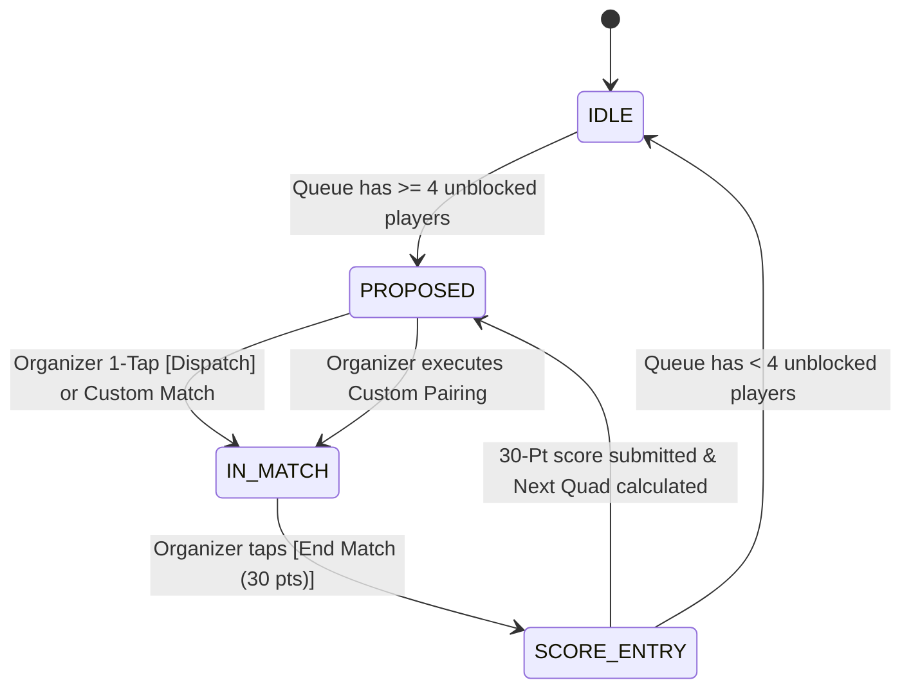

# Courtside Queue Board Specification & Interactive Prototype Architecture

**Issue**: [#11 Prototype: Interactive Courtside Queue and Rotation Board](https://github.com/kidomarcostelo/badminque/issues/11)  
**Parent Map**: [#7 Map: Courtside Queueing, Rotation, and Matchmaking Engine](https://github.com/kidomarcostelo/badminque/issues/7)  
**Branch**: `prototype/courtside-queue-board`  
**Prototype Artifact**: [`prototypes/courtside-queue-board.html`](file:///data/data/com.termux/files/home/repo/badminque/prototypes/courtside-queue-board.html)  

---

## 1. Executive Summary & Purpose

This document specifies the courtside interface architecture and reactive state machine for Badminque’s **3-Court Doubles Queueing & Rotation Engine**, prototyped and validated in [`prototypes/courtside-queue-board.html`](file:///data/data/com.termux/files/home/repo/badminque/prototypes/courtside-queue-board.html).

The prototype incorporates user and domain feedback:
1. **30-Point Match Scoring**: Standard badminton recreational format (30-point single set). 1-tap score presets (30-28, 30-25, 30-20, 30-15, 30-8) allow logging in under 5 seconds.
2. **Extended On-Deck Pool (Up to 3 Matches / Pair-Grouped)**:
   - Displays up to 3 upcoming matches (`Next Up`, `Following`, `In the Hole`).
   - Grouped cleanly into **Pair A** vs **Pair B** (rather than an unformatted list of 4 players), giving instant visibility to resting players and the Organizer.
3. **Touch-First Tap Ergonomics (No Drag-and-Drop)**:
   - Eliminates fragile HTML5 drag-and-drop on tablet/mobile screens.
   - Introduces **Tap-to-Assign** and a dedicated **Custom Match Builder**: Organizers tap any player or click `[+ Custom Match Builder]` to dispatch matches directly to Court 1, 2, or 3.
4. **Asynchronous Rolling Independent Dispatch**: Courts finish independently (10–25 minutes); score entry triggers immediate 4-player step-off and rolling next-match fill without waiting for other courts.
5. **Organizer Co-Pilot Dispatch**: Matches are never force-dispatched on cold autopilot; instead, the engine generates an optimal 4-player pairing card on the cleared court, allowing the Organizer to launch the match in 1 tap (`[⚡ Dispatch]`) or quickly swap players if someone stepped away.
6. **Equal Match Fairness & Tie-Breaking**: Bench queue sorting strictly prioritizes lowest match count ($M_i$), breaking ties by cumulative rest duration ($t_{\text{wait}}$).
7. **Locked Pair Arrival Anchoring**: Custom pinned pairs are anchored to the later arrival time ($\max(t_a, t_b)$), preventing line cutting when one partner is on court.

---

## 2. Court Station State Machine

### State Definitions
- **`IDLE`**: Court is empty; insufficient queued players are ready to form a quad.
- **`PROPOSED`**: The matchmaking engine has computed the optimal 4-player pairing based on the active policy, structured as Pair A vs Pair B. The card features a prominent `[⚡ Dispatch to Court]` button and an inline `[Customize]` button.
- **`IN_MATCH`**: Active 4-player doubles match in progress. Live elapsed timer counts up.
- **`SCORE_ENTRY`**: Match concluded. 6 preset 30-point score buttons enable single-gesture logging. Submitting score marks all 4 on-court players as finished, applies the Badminton Stamina Invariant (all 4 step off to rest), and transitions the court to `PROPOSED`.

---

## 3. Waiting Queue Priority Mathematics

The queue ranking score $Q(i)$ for roster player $i$ is calculated as:

$$Q(i) = t_{\text{wait}} - C_{\text{match}} \cdot M_i + \delta_{\text{skip}} \cdot S_i$$

Where:
- $t_{\text{wait}}$: Cumulative seconds since entering the queue or completing previous match.
- $M_i$: Total matches completed this Club Night.
- $C_{\text{match}}$: Penalty constant ($C_{\text{match}} = 1800\,\text{s} = 30\,\text{min}$) heavily prioritizing players with fewer matches.
- $S_i$: Boolean flag ($1$ if returning from a 1-Match Skip breather, $0$ otherwise).
- $\delta_{\text{skip}}$: Priority boost ($\delta_{\text{skip}} = 600\,\text{s} = 10\,\text{min}$) guaranteeing immediate next-match inclusion.

---

## 4. Edge Cases Verified in Prototype

| Edge Case | State Handling in Prototype | Verified Behavior |
| :--- | :--- | :--- |
| **Custom Pairing Tap-Assign** | Organizer selects 4 specific players via Custom Match Builder. | Bypassed players retain full accumulated wait time ($t_{\text{wait}}$). Selected players launch on chosen court without drag-and-drop. |
| **Locked Pair Asynchronous Arrival** | Partner A playing on Court 1; Partner B waiting on bench. | Partner B marked `WAITING_PARTNER`. Pair activates only when Court 1 finishes, anchored at Partner A's completion time. No line cutting. |
| **Touch-First Override of Resting Player** | Organizer taps resting player and assigns to Court 2. | Frictionless override: Player transitions directly to `PLAYING`. On completion, returns to `QUEUED` with incremented match count. |
| **1-Match Skip Breather** | Player toggles 1-skip. | Player sits out current dispatch. Once match launches, player unskips with elevated priority boost, entering the very next court opening. |
| **Virtual Ladder Dynamic Courts** | Court 1 King match finishes. | Winners remain in Apex virtual tier; losers demote to Challenger tier. When next dispatched, partners are mandatorily split across the net. |

---

## 5. UI Ergonomics & Future Design Alignment (Google Stitch)

1. **Touch Ergonomics**: All interactions utilize large tap targets ($\ge 44 \times 44\,\text{px}$) with dedicated modal sheets for player actions and custom match building.
2. **Component Modularity**: The prototype logic (state machine, queue algorithms, pair partitioners) is decoupled from the DOM rendering layer, allowing seamless future restyling using Google Stitch or Next.js Tailwind components.

---

## 6. Future UI Direction: The "Spreadsheet-Familiar One-Pager" Paradigm

1. **Organizer Mental Model**: Recreational badminton Organizers are deeply accustomed to managing sessions using dense personal spreadsheets (Google Sheets / Excel) where all courts, active matches, and the waiting bench are visible simultaneously without screen transitions.
2. **One-Pager Architectural Principle**: To drive high Organizer adoption, the production UI must reject nested navigation menus, multi-page flows, or hidden sub-tabs. The full venue status—Active 3 Courts, 3 On-Deck Staging Slots (2 automated + 1 custom staging), and the Roster Queue table—must sit on a single, dense landscape tablet canvas.
3. **Glanceable Tabular Density**: The waiting bench retains spreadsheet-grade information density (rating, match counts, rest minutes, availability status) with touch-first tap action sheets, ensuring the Organizer can parse courtside status in 2 seconds.

