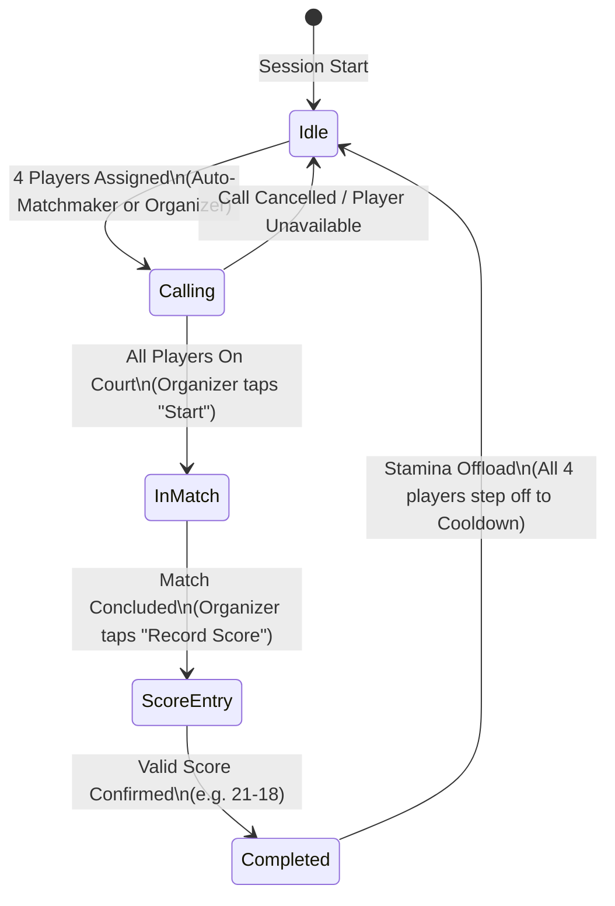

# Recreational Sports Queueing and Fair Rotation Algorithms

**Status**: Proposed  
**Date**: 2026-10-10  
**Context**: Badminque Courtside Queueing, Rotation, and Matchmaking Engine (Map #7, Issue #8)  
**Related Documents**: `GLOSSARY.md`, `CODING_STANDARDS.md`, `docs/adr/0001-tech-stack-decision.md`, `docs/research/rating-algorithm-spec.md`  

---

## 1. Executive Summary & Domain Context

Badminque provides universal skill transparency and seamless session management for recreational badminton clubs. A typical **Club Night** operates in a multi-court sports hall where an **Organizer** manages player rotations on a courtside tablet under an offline-first Next.js PWA architecture (ADR 0001).

The courtside operational reference model is benchmarked at **3 courts**, dedicated **exclusively to doubles** (4 players per court, 12 active players on courts simultaneously), accommodating club rosters typically ranging from **16 to 28 players**.

Recreational sports rotation engines must resolve a fundamental trilemma between:
1. **Mathematical Fairness**: Minimizing variance in match counts ($\sigma_M^2 \to 0$) and wait times across all roster players.
2. **Social & Competitive Quality**: Maximizing partner and opponent variety (avoiding repetitive pairings) while pairing players within enjoyable skill bands.
3. **Zero-Friction Courtside Operation**: Requiring minimal tablet interaction from the Organizer during high-tempo gameplay, functioning reliably in offline gymnasiums.

### 1.1 Strict Domain Invariants

All algorithms and state machines in this specification adhere strictly to the following invariants:

1. **Badminton Stamina Invariant**: All 4 players **must step off the court** upon match completion. Consecutive court-staying (e.g. "winners stay on court" common in pickleball or tennis) is strictly prohibited. Badminton singles and doubles involve explosive anaerobic intervals, high heart-rate zones, and rapid change-of-direction rallies. Forcing or allowing players to remain on court leads to physical exhaustion, increased injury risk, perceived favoritism, and court hoarding.
2. **Locked Pair Invariant**: Custom pinned pairs (e.g. fixed doubles partners preparing for an external tournament) enter the queue at the **later of their two natural arrival/readiness positions**:
   $$\text{QueuePosition}(P_{\{a, b\}}) = \max\left(\text{QueuePosition}(a), \; \text{QueuePosition}(b)\right)$$
   This prevents line cutting: a player who has rested for 25 minutes cannot partner with a player who just stepped off court to immediately pull them back into an active match ahead of other waiting players.
3. **1-Match Skip Priority Retention**: A player or pair who declines a court call or requests a temporary pause (e.g. catching breath, bathroom break, re-stringing a racket) transitions to a `Skipped` state. They retain their queue priority and sit at the head of the candidate pool for the immediately subsequent court opening, rather than being penalized with demotion to the back of the queue.
4. **Organizer Preemption Authority**: The Organizer retains sovereign manual override control on the courtside tablet. Any automated recommendation can be modified via drag-and-drop. Manual actions must preserve historical integrity and append to an offline audit log.

---

## 2. Comparative Analysis of Recreational Queueing Systems

| System / Discipline | Primary Mechanics | Strengths | Fatal Flaws for Recreational Badminton |
| :--- | :--- | :--- | :--- |
| **Physical Badminton Pegboard** (Clothespin Board) | Clothespins on numbered rails. Top peg is "The Picker", who selects 3 players from a top "Pick Zone" window (next 6–8 pegs). | Tangible, self-governing, transparent physical presence courtside. | Susceptible to social cliquishness, cherry-picking easy matchups, and the "wallflower problem" where weaker/shy players are repeatedly skipped. Peg tampering is common. |
| **Pickleball Paddle Saddle / Rack** | Paddles stacked in physical PVC tubes or wire fence racks. 4-on-4-off or 2-on-2-off (winners stay, split). | Zero technology barrier; strict FIFO line discipline. | Pure FIFO ignores skill matching, leading to lopsided blowouts. 2-on-2-off violates the Badminton Stamina Invariant. Does not account for late arrivals. |
| **Squash / Tennis Box Rotations** | Timed buzzer rotations (e.g., 15-minute whistle). All courts freeze and rotate synchronously. | Predictable time blocks; eliminates queue drift. | Abruptly terminates exciting deuce rallies mid-point; rigid structure collapses when court headcounts fluctuate or players take rest breaks. |
| **Generic Tournament Software** (Bracket apps) | Pre-computed static round-robin pairings or Swiss brackets. | Mathematically provable schedule balance. | Completely unviable courtside: cannot handle dynamic drop-ins, early departures, variable match durations, or spontaneous stamina rests. |
| **Badminque Courtside Engine** | Hybrid dynamic priority queue with fair play aging, anti-repetition partner graphs, and staggered court state machines. | Solves social cliquishness, enforces stamina rest, balances match counts, supports 1-tap tablet score entry, and functions offline. | Requires carefully tuned aging parameters and clear visual feedback for the Organizer. |

---

## 3. Mathematical Formulations of Queue Priority Scoring

### 3.1 Fair Play Aging Metric

To prevent court monopolization while ensuring late arrivals or rested players are seamlessly integrated, queue position is evaluated via a dynamic **Priority Index** $Q(i)$.

Let:
- $M_i \in \mathbb{N}_0$ be the cumulative count of matches completed by player $i$ during the current Club Night.
- $t_{\text{current}}$ be the current session time (in seconds).
- $t_{\text{ready}, i}$ be the timestamp when player $i$ entered the `Queued` state (either upon initial check-in, stepping off court after cooldown, or returning from `Resting`).
- $t_{\text{wait}, i} = \max(0, t_{\text{current}} - t_{\text{ready}, i})$ be the continuous elapsed wait time.
- $C_{\text{match}}$ be the **Match Equivalence Weight** (in seconds), representing the wait time mathematically equivalent to playing one match. In standard badminton doubles, matches average 15 minutes ($900\text{ s}$).
- $S_i \in \{0, 1\}$ indicate whether player $i$ currently holds a `1-Match Skip` token.
- $\delta_{\text{skip}}$ be the priority boost constant assigned to skipped players.

The **Priority Index** $Q(i)$ is defined as:

$$Q(i) = t_{\text{wait}, i} - C_{\text{match}} \cdot M_i + \delta_{\text{skip}} \cdot S_i + \epsilon_i$$

Where:
- Higher $Q(i)$ indicates higher urgency for court assignment.
- $\epsilon_i = \frac{10^{-6}}{\text{check\_in\_order}_i + 1}$ is a deterministic infinitesimal tie-breaker preserving strict FIFO order when match counts and wait times are identical.
- Setting $\delta_{\text{skip}} = 2 \cdot C_{\text{match}}$ guarantees that a skipped player immediately outranks players with equal or greater match counts upon the next court opening.

```
Priority Index Q(i)
 ▲
 │                          Player B (M=1, waited 18m) -> Q = 18 - 15 = +3m
 │                         /
 │                        /   Player A (M=2, waited 32m) -> Q = 32 - 30 = +2m
 │                       /   /
 │                      /   /    Player C (M=0, newly checked in) -> Q = 0m
 │                     /   /    /
─┼────────────────────┼───┼────┼────────────────────────►
 │                   +3  +2    0
```

### 3.2 Starvation Bound & Variance Guarantees

Under continuous session operation with total active players $N > 4 \times C_{\text{courts}}$:

1. **Starvation Bound**: A player $i$ with match count $M_i$ will never wait longer than:
   $$t_{\text{starve}} \le C_{\text{match}} \cdot (M_i - \min_{j} M_j) + \tau_{\text{cycle}}$$
   where $\tau_{\text{cycle}} \approx \frac{\overline{D} \cdot N}{4 \cdot C_{\text{courts}}}$ is the nominal court turnaround cycle.
2. **Match Count Variance**: For all players continuously available throughout the session, the priority function guarantees:
   $$\max_{i, j} |M_i - M_j| \le 1$$
   at the conclusion of every full rotation round.

---

## 4. Partner Anti-Repetition Graphs & Split & Mix Pairing

When 4 candidate players $\mathcal{P} = \{p_1, p_2, p_3, p_4\}$ are drawn from the priority queue, they can be partitioned into two competing doubles teams in exactly 3 distinct configurations:

$$\mathcal{C}_1: \{p_1, p_2\} \text{ vs } \{p_3, p_4\}$$
$$\mathcal{C}_2: \{p_1, p_3\} \text{ vs } \{p_2, p_4\}$$
$$\mathcal{C}_3: \{p_1, p_4\} \text{ vs } \{p_2, p_3\}$$

### 4.1 Pairing Optimization Objective Function

To select the configuration that maximizes social variety and competitive parity, the matchmaking engine minimizes a composite cost function:

$$J(\mathcal{C}) = w_P \cdot C_{\text{partner}}(\mathcal{C}) + w_O \cdot C_{\text{opp}}(\mathcal{C}) + w_R \cdot C_{\text{rating}}(\mathcal{C})$$

Default calibrated weights:
$$w_P = 100.0, \quad w_O = 25.0, \quad w_R = 1.0$$

#### 1. Recency-Decayed Partner Penalty ($C_{\text{partner}}$)
Let $H_P(u, v)$ be the cumulative count of matches where players $u$ and $v$ were partners. Let $m_{\text{last}}(u, v)$ be the session match sequence index of their most recent partnership, and $m_{\text{curr}}$ be the current session match count.

$$\text{Pen}_P(u, v) = 10 \cdot H_P(u, v) + 50 \cdot \exp\left(-\frac{m_{\text{curr}} - m_{\text{last}}(u, v)}{2.0}\right)$$

For configuration $\mathcal{C} = \{\{u, v\}, \{x, y\}\}$:
$$C_{\text{partner}}(\mathcal{C}) = \text{Pen}_P(u, v) + \text{Pen}_P(x, y)$$

#### 2. Recency-Decayed Opponent Penalty ($C_{\text{opp}}$)
Similarly, to prevent consecutive rematches against the same opponents:
$$C_{\text{opp}}(\mathcal{C}) = \sum_{a \in \{u, v\}} \sum_{b \in \{x, y\}} \left[ 2 \cdot H_O(a, b) + 10 \cdot \exp\left(-\frac{m_{\text{curr}} - m_{\text{last\_opp}}(a, b)}{1.5}\right) \right]$$

#### 3. Weak-Link Rating Balance Penalty ($C_{\text{rating}}$)
Using Badminque's canonical weak-link soft mean formula (`docs/research/rating-algorithm-spec.md`):

$$R_{\text{team}}(a, b) = \frac{R_a + R_b}{2} - 0.08 \cdot |R_a - R_b|$$

$$C_{\text{rating}}(\mathcal{C}) = \left| R_{\text{team}}(u, v) - R_{\text{team}}(x, y) \right|$$

This formulation penalizes pairing two dominant players together, naturally discovering the combination that balances the court.

### 4.2 Win-Lose Split & Mix Policy

In the **Split & Mix** rotation policy, when 4 players finish a match together (or advance as a quad from the queue):
- **Winners**: $W_1, W_2$
- **Losers**: $L_1, L_2$

The policy **mandates** that the winning partners split:
- Configuration A: $\{W_1, L_1\} \text{ vs } \{W_2, L_2\}$
- Configuration B: $\{W_1, L_2\} \text{ vs } \{W_2, L_1\}$

Configuration $\{W_1, W_2\} \text{ vs } \{L_1, L_2\}$ is discarded. The engine evaluates:
$$\Delta R_A = |R_{\text{team}}(W_1, L_1) - R_{\text{team}}(W_2, L_2)|$$
$$\Delta R_B = |R_{\text{team}}(W_1, L_2) - R_{\text{team}}(W_2, L_1)|$$

The configuration with $\min(\Delta R_A, \Delta R_B)$ is selected. This produces 50/50 competitive games and guarantees partner cycling.

---

## 5. Court Ladder State Machine (3-Court Hierarchical Setup)

The Court Ladder arranges courts in a hierarchical progression:
- **Court 1 (Apex / King Court)**: Highest skill tier.
- **Court 2 (Intermediate / Challenger Court)**: Middle tier.
- **Court 3 (Base / Foundation Court)**: Entry tier.

```
       ┌────────────────────────┐
       │ Court 1 (King / Apex)  │◄─── Promoted Winners from Court 2
       └───────────┬────────────┘
                   │ Losers demote
                   ▼
       ┌────────────────────────┐
       │   Court 2 (Challenger) │◄─── Promoted Winners from Court 3
       └───────────┬────────────┘
                   │ Losers demote
                   ▼
       ┌────────────────────────┐
       │    Court 3 (Base)      │◄─── Demoted Losers from Court 2
       └────────────────────────┘
```

### 5.1 Promotion & Demotion Invariants

1. **Court 1**: Winners remain at Court 1 (King defenders); Losers demote to Court 2.
2. **Court 2**: Winners promote to Court 1; Losers demote to Court 3.
3. **Court 3**: Winners promote to Court 2; Losers remain at Court 3 (Foundation).
4. **Mandatory Partner Split on Arrival**: Moving pairs do **not** remain partners on their destination court. On arrival, the incoming promoting pair and the retaining (or demoting) pair are split and mixed:
   $$\{P_{\text{prom}, 1}, P_{\text{dem}, 1}\} \text{ vs } \{P_{\text{prom}, 2}, P_{\text{dem}, 2}\}$$
   This prevents dominant duos from monopolizing Court 1 indefinitely.

### 5.2 Asynchronous Completion & Staggered Buffering

In live club play, courts do not finish simultaneously. Court 1 may finish in 12 minutes, Court 2 in 22 minutes, and Court 3 in 15 minutes. Synchronous blocking (holding Court 1 idle until Court 2 finishes) causes unacceptable court downtime.

To resolve this, Badminque implements the **Staggered Buffer Pattern**:

```
Court k Finished
       │
       ▼
[Match Completed] ──► Release all 4 players to Cooldown (Stamina Invariant)
       │
       ├─► Winners (Pair) ──► Target Court k-1 Arrival Buffer
       └─► Losers  (Pair) ──► Target Court k+1 Arrival Buffer
                                   │
                                   ▼
                   Destination Court Idle Check:
                   ├─► Both Buffers Full (4 players ready)? ──► Launch Split & Mix Match!
                   └─► Buffer Incomplete?
                           │
                           ▼
                       Wait Timer <= 3 mins? ──► Hold Court (Show countdown)
                       Wait Timer > 3 mins?  ──► Backfill from Global Priority Queue
```

- Each Court $k$ maintains an **Incoming Arrival Buffer** holding up to two pairs (Pair Promoted from below, Pair Demoted from above).
- If Court $k$ becomes idle while waiting for its incoming challenger pair from Court $k \pm 1$, a configurable **Flex Wait Threshold** ($\tau_{\text{flex}} = 180\text{ s}$) activates:
  - If the opposing court is estimated to finish within $\tau_{\text{flex}}$, Court $k$ briefly holds.
  - If the opposing court exceeds $\tau_{\text{flex}}$, the engine **dynamically backfills** the vacant 2 slots from the head of the global priority queue, preserving 100% court utilization while preventing gym bottlenecks.

---

## 6. Flighted Tier Partition vs. Unified Queue with Rating Banding

Club nights alternate between two matchmaking philosophies depending on roster size and skill heterogeneity:

### 6.1 Architectural Comparison

| Dimension | Policy A: Flighted Tier Partition | Policy B: Unified Queue with Dynamic Banding |
| :--- | :--- | :--- |
| **Concept** | Disjoint skill pools (Flight A: $\ge 1700$, Flight B: $1400\text{--}1700$, Flight C: $<1400$). | Single global queue prioritized by aging $Q(i)$, with rating-bounded candidate filtering. |
| **Court Assignment** | Statically dedicated courts (Court 1 = Flight A, Court 2 = Flight B, Court 3 = Flight C) or round-robin lease. | All 3 courts draw from the global pool; court assignment is fully dynamic. |
| **Skill Protection** | Absolute isolation. Beginners never encounter elite smashers. | High protection during peak queue depth; relaxes gracefully during low attendance. |
| **Headcount Resilience** | **Fragile**. If 5 players attend Flight A and 15 attend Flight B, Court 1 sits idle while Court 2 is bottlenecked. | **Optimal**. Automatically balances wait times regardless of attendance distribution. |
| **Best Used When** | Large club sessions ($>24$ players) with extreme skill bimodal distribution. | Standard club sessions ($12\text{--}24$ players) prioritizing equal court time. |

### 6.2 Dynamic Band Expansion Algorithm

Under Policy B, when a court becomes idle:
1. The player with the highest priority index $p_1 = \arg\max Q(i)$ is selected.
2. Candidate partners and opponents must fall within an initial rating band:
   $$|R_j - R_{p1}| \le \Delta R_{\text{band}}(t)$$
3. The band expands dynamically based on player 1's wait time:
   $$\Delta R_{\text{band}}(t) = \Delta R_{\text{base}} + \gamma \cdot \max\left(0, \; t_{\text{wait}, p1} - \tau_{\text{target}}\right)$$
   Where:
   - $\Delta R_{\text{base}} = 150 \text{ rating points}$
   - $\gamma = 0.5 \text{ points / second}$ ($30\text{ pts/min}$)
   - $\tau_{\text{target}} = 600\text{ s}$ (10 minutes)

This guarantees that skill matching is strictly enforced when the queue is deep, but gracefully relaxes to prevent long wait times when players are scarce.

---

## 7. Organizer Manual Overrides, Pinned Pairs, and Rest Cycles

Courtside reality requires the Organizer to handle unexpected human disruptions without corrupting automated queues.

```
             ┌─────────────────────────────────────────────────────────┐
             │               Organizer Tablet Actions                  │
             └───────┬───────────────────┬──────────────────┬──────────┘
                     │                   │                  │
                     ▼                   ▼                  ▼
             [Drag-to-Reorder]     [Pin Custom Pair]    [Toggle Rest]
                     │                   │                  │
                     ▼                   ▼                  ▼
            Manual Slot Swap     Locked Pair Rule    Pause Wait Timer
            (Logged in Audit)    (Later Position)    (Retain Match Count)
```

### 7.1 Locked Custom Pairs
- **Use Case**: Fixed tournament partners requesting to play together.
- **Rule Enforcement**: The pair is treated as an indivisible atomic entity $\mathbf{P} = \{p_a, p_b\}$.
- Its queue entry timestamp is assigned strictly according to the **Locked Pair Invariant**:
  $$t_{\text{ready}}(\mathbf{P}) = \max\left(t_{\text{ready}}(p_a), \; t_{\text{ready}}(p_b)\right)$$
  $$M(\mathbf{P}) = \max\left(M(p_a), \; M(p_b)\right)$$
  This guarantees that neither player can use the partnership to bypass the queue.

### 7.2 1-Match Skip vs. Resting State
- **1-Match Skip (`Skipped`)**: Player remains at the top of the queue for the very next match. Triggered by a quick breather or shoe change.
- **Resting (`Resting`)**: Player steps off the queue completely (e.g. eating snack, extended rest, nursing minor cramp). Their wait-time accumulation pauses. When toggled back to `Queued`, their wait timer resets to 0, but their total match count $M_i$ is preserved, preventing them from unfairly dominating court time upon return.

### 7.3 Manual Courtside Drag-and-Drop
- The Organizer can drag any queued player onto an active court station or swap scheduled pairings.
- An immutable `OverrideAuditLog` entry is appended to IndexedDB, capturing:
  `{ timestamp, organizerId, actionType, previousState, newState, reason }`.

---

## 8. State Transition Diagrams

### 8.1 Court Station State Machine



### 8.2 Player Availability State Machine

```mermaid
stateDiagram-v2
    [*] --> Queued: Check-in / Session Entry
    
    Queued --> Calling: Selected for Court
    
    Calling --> Playing: Match Started
    Calling --> Skipped: Declines Court Call (1-Match Skip)
    Calling --> Resting: Player Takes Break
    
    Skipped --> Queued: Priority Boost Applied\n(Top of next cycle)
    
    Playing --> Cooldown: Match Finished (All 4 step off)
    
    Cooldown --> Queued: Cooldown Expired (e.g. 60s)\nWait timer restarts
    Cooldown --> Resting: Player Requests Extended Rest
    
    Resting --> Queued: Player Toggles Ready\n(Wait timer = 0, M preserved)
    
    Queued --> Resting: Player Steps Away
```



---

## 9. Concrete TypeScript Reference Algorithms

### 9.1 Fair Play Priority Scoring & Selection

```typescript
/**
 * Types and algorithms for Fair Play Queue priority scoring and selection.
 * Strictly adheres to CODING_STANDARDS.md (no nested ternaries, guard clauses, strict typing).
 */

export interface QueuePlayer {
  readonly id: string;
  readonly name: string;
  readonly doublesRating: number;
  readonly matchesPlayed: number;
  readonly readyTimestamp: number; // Unix epoch milliseconds
  readonly isSkipped: boolean;
  readonly checkInSequence: number;
  readonly lockedPartnerId?: string;
}

export interface MatchSelectionCandidate {
  readonly player: QueuePlayer;
  readonly priorityScore: number;
}

const AVERAGE_MATCH_DURATION_MS = 15 * 60 * 1000; // 15 minutes
const SKIP_PRIORITY_BOOST_MS = 30 * 60 * 1000;    // 30 minutes boost

/**
 * Calculates the dynamic priority score for a queued player.
 * Higher score indicates higher urgency for court assignment.
 */
export function calculateQueuePriority(
  player: QueuePlayer,
  currentTimestamp: number
): number {
  const waitDurationMs = Math.max(0, currentTimestamp - player.readyTimestamp);
  const matchPenaltyMs = player.matchesPlayed * AVERAGE_MATCH_DURATION_MS;
  const skipBonusMs = player.isSkipped ? SKIP_PRIORITY_BOOST_MS : 0;
  
  // Infinitesimal deterministic FIFO tie-breaker
  const tieBreaker = 1 / (player.checkInSequence + 1);

  return waitDurationMs - matchPenaltyMs + skipBonusMs + tieBreaker;
}

/**
 * Selects the top 4 players for the next doubles match, respecting the Locked Pair Invariant.
 */
export function selectNextDoublesQuad(
  queue: readonly QueuePlayer[],
  currentTimestamp: number
): QueuePlayer[] {
  if (queue.length < 4) {
    return [];
  }

  // Calculate scores and sort descending
  const scoredCandidates: MatchSelectionCandidate[] = queue.map((player) => ({
    player,
    priorityScore: calculateQueuePriority(player, currentTimestamp),
  }));

  scoredCandidates.sort((a, b) => b.priorityScore - a.priorityScore);

  const selectedPlayers: QueuePlayer[] = [];
  const selectedIds = new Set<string>();

  for (const candidate of scoredCandidates) {
    const player = candidate.player;

    if (selectedIds.has(player.id)) {
      continue;
    }

    // Handle Locked Pair Invariant
    if (player.lockedPartnerId !== undefined) {
      const partnerId = player.lockedPartnerId;
      const partnerCandidate = scoredCandidates.find(
        (c) => c.player.id === partnerId && !selectedIds.has(c.player.id)
      );

      // Both partner slots must be available
      if (!partnerCandidate) {
        continue;
      }

      if (selectedPlayers.length + 2 > 4) {
        continue;
      }

      selectedPlayers.push(player);
      selectedPlayers.push(partnerCandidate.player);
      selectedIds.add(player.id);
      selectedIds.add(partnerId);
    } else {
      selectedPlayers.push(player);
      selectedIds.add(player.id);
    }

    if (selectedPlayers.length === 4) {
      break;
    }
  }

  if (selectedPlayers.length < 4) {
    return [];
  }

  return selectedPlayers;
}
```

### 9.2 Split & Mix Optimal Doubles Pairing

```typescript
export interface DoublesPairing {
  readonly teamA: readonly [QueuePlayer, QueuePlayer];
  readonly teamB: readonly [QueuePlayer, QueuePlayer];
  readonly totalPenaltyCost: number;
}

export interface CoPlayHistoryLookup {
  getPartnerCount(playerAId: string, playerBId: string): number;
  getOpponentCount(playerAId: string, playerBId: string): number;
  getLastPartnerMatchIndex(playerAId: string, playerBId: string): number;
}

/**
 * Calculates Badminque's canonical weak-link soft mean rating for a doubles team.
 * Formula: (R1 + R2) / 2 - 0.08 * |R1 - R2|
 */
export function calculateTeamRating(rating1: number, rating2: number): number {
  const averageRating = (rating1 + rating2) / 2;
  const ratingSpread = Math.abs(rating1 - rating2);
  const WEAK_LINK_COEFFICIENT = 0.08;

  return averageRating - WEAK_LINK_COEFFICIENT * ratingSpread;
}

/**
 * Evaluates the 3 possible doubles configurations for 4 players,
 * returning the configuration minimizing partner/opponent repetition and rating disparity.
 */
export function findOptimalDoublesPairing(
  players: readonly [QueuePlayer, QueuePlayer, QueuePlayer, QueuePlayer],
  history: CoPlayHistoryLookup,
  currentMatchIndex: number
): DoublesPairing {
  const [p0, p1, p2, p3] = players;

  // The 3 possible doubles pairings
  const configurations: Array<{
    teamA: [QueuePlayer, QueuePlayer];
    teamB: [QueuePlayer, QueuePlayer];
  }> = [
    { teamA: [p0, p1], teamB: [p2, p3] },
    { teamA: [p0, p2], teamB: [p1, p3] },
    { teamA: [p0, p3], teamB: [p1, p2] },
  ];

  let bestPairing: DoublesPairing | null = null;
  let lowestPenalty = Number.POSITIVE_INFINITY;

  for (const config of configurations) {
    const penalty = evaluateConfigurationCost(
      config.teamA,
      config.teamB,
      history,
      currentMatchIndex
    );

    if (penalty < lowestPenalty) {
      lowestPenalty = penalty;
      bestPairing = {
        teamA: config.teamA,
        teamB: config.teamB,
        totalPenaltyCost: penalty,
      };
    }
  }

  if (bestPairing === null) {
    throw new Error("Failed to evaluate doubles pairings: empty configurations");
  }

  return bestPairing;
}

function evaluateConfigurationCost(
  teamA: [QueuePlayer, QueuePlayer],
  teamB: [QueuePlayer, QueuePlayer],
  history: CoPlayHistoryLookup,
  currentMatchIndex: number
): number {
  const PARTNER_WEIGHT = 100.0;
  const OPPONENT_WEIGHT = 25.0;
  const RATING_WEIGHT = 1.0;

  // 1. Partner penalty
  const partnerCountA = history.getPartnerCount(teamA[0].id, teamA[1].id);
  const partnerCountB = history.getPartnerCount(teamB[0].id, teamB[1].id);
  const lastMatchA = history.getLastPartnerMatchIndex(teamA[0].id, teamA[1].id);
  const lastMatchB = history.getLastPartnerMatchIndex(teamB[0].id, teamB[1].id);

  const recencyA = Math.exp(-(currentMatchIndex - lastMatchA) / 2);
  const recencyB = Math.exp(-(currentMatchIndex - lastMatchB) / 2);

  const partnerPenalty =
    partnerCountA * 10 + recencyA * 50 + partnerCountB * 10 + recencyB * 50;

  // 2. Opponent penalty
  let opponentPenalty = 0;
  for (const playerA of teamA) {
    for (const playerB of teamB) {
      opponentPenalty += history.getOpponentCount(playerA.id, playerB.id) * 2;
    }
  }

  // 3. Rating differential penalty
  const ratingTeamA = calculateTeamRating(
    teamA[0].doublesRating,
    teamA[1].doublesRating
  );
  const ratingTeamB = calculateTeamRating(
    teamB[0].doublesRating,
    teamB[1].doublesRating
  );
  const ratingDisparity = Math.abs(ratingTeamA - ratingTeamB);

  return (
    PARTNER_WEIGHT * partnerPenalty +
    OPPONENT_WEIGHT * opponentPenalty +
    RATING_WEIGHT * ratingDisparity
  );
}
```

### 9.3 3-Court Asynchronous Ladder Promotion & Demotion

```typescript
export interface LadderCourtStation {
  readonly courtNumber: 1 | 2 | 3;
  readonly activeMatchId: string | null;
  readonly incomingTopBuffer: QueuePlayer[];    // Winners from court below or retaining
  readonly incomingBottomBuffer: QueuePlayer[]; // Losers from court above or retaining
}

export interface MatchResultRecord {
  readonly courtNumber: 1 | 2 | 3;
  readonly winnerPair: [QueuePlayer, QueuePlayer];
  readonly loserPair: [QueuePlayer, QueuePlayer];
}

export interface LadderTransitionResult {
  readonly updatedCourts: Record<1 | 2 | 3, LadderCourtStation>;
  readonly nextMatchReadyCourt: 1 | 2 | 3 | null;
}

/**
 * Handles match completion in the 3-Court Hierarchical Ladder.
 * Routes winners up toward Court 1 and losers down toward Court 3.
 */
export function handleLadderMatchCompletion(
  completedResult: MatchResultRecord,
  currentCourts: Record<1 | 2 | 3, LadderCourtStation>
): LadderTransitionResult {
  const { courtNumber, winnerPair, loserPair } = completedResult;

  // Clone court stations immutably
  const updatedCourts: Record<1 | 2 | 3, LadderCourtStation> = {
    1: { ...currentCourts[1], incomingTopBuffer: [...currentCourts[1].incomingTopBuffer], incomingBottomBuffer: [...currentCourts[1].incomingBottomBuffer] },
    2: { ...currentCourts[2], incomingTopBuffer: [...currentCourts[2].incomingTopBuffer], incomingBottomBuffer: [...currentCourts[2].incomingBottomBuffer] },
    3: { ...currentCourts[3], incomingTopBuffer: [...currentCourts[3].incomingTopBuffer], incomingBottomBuffer: [...currentCourts[3].incomingBottomBuffer] },
  };

  // Mark current court idle
  updatedCourts[courtNumber] = {
    ...updatedCourts[courtNumber],
    activeMatchId: null,
  };

  // 1. Route winners
  if (courtNumber === 1) {
    // King Court winners stay on Court 1 (top buffer)
    updatedCourts[1].incomingTopBuffer.push(...winnerPair);
  } else if (courtNumber === 2) {
    // Court 2 winners promote to Court 1 (bottom challenger buffer)
    updatedCourts[1].incomingBottomBuffer.push(...winnerPair);
  } else {
    // Court 3 winners promote to Court 2 (bottom challenger buffer)
    updatedCourts[2].incomingBottomBuffer.push(...winnerPair);
  }

  // 2. Route losers
  if (courtNumber === 1) {
    // Court 1 losers demote to Court 2 (top buffer)
    updatedCourts[2].incomingTopBuffer.push(...loserPair);
  } else if (courtNumber === 2) {
    // Court 2 losers demote to Court 3 (top buffer)
    updatedCourts[3].incomingTopBuffer.push(...loserPair);
  } else {
    // Court 3 losers stay on Court 3 (bottom buffer)
    updatedCourts[3].incomingBottomBuffer.push(...loserPair);
  }

  // 3. Find if any court now has 4 players ready to launch
  let nextMatchReadyCourt: 1 | 2 | 3 | null = null;
  for (const cNum of [1, 2, 3] as const) {
    const court = updatedCourts[cNum];
    const totalBufferedPlayers =
      court.incomingTopBuffer.length + court.incomingBottomBuffer.length;
    
    if (court.activeMatchId === null && totalBufferedPlayers >= 4) {
      nextMatchReadyCourt = cNum;
      break;
    }
  }

  return {
    updatedCourts,
    nextMatchReadyCourt,
  };
}
```

---

## 10. Offline-First IndexedDB Data Structures

In conformance with ADR 0001, courtside queue state is stored client-side in IndexedDB using structured object stores.

```typescript
/**
 * Offline-First IndexedDB Schema Definitions for Badminque Courtside Operations.
 * Database Name: "badminque_offline_db"
 * Version: 1
 */

export interface ClubNightQueueStore {
  readonly sessionId: string; // UUID v4
  readonly organizerUserId: string;
  readonly activePolicy: "FAIR_PLAY_PEGBOARD" | "SPLIT_AND_MIX" | "COURT_LADDER" | "FLIGHTED_TIERS";
  readonly courtCount: 3;
  readonly isOnlineSyncPending: boolean;
}

export type CourtStatus = "IDLE" | "CALLING" | "IN_MATCH" | "SCORE_ENTRY" | "COMPLETED";

export interface CourtStationRecord {
  readonly courtNumber: 1 | 2 | 3;
  readonly sessionId: string;
  readonly status: CourtStatus;
  readonly activeMatchId: string | null;
  readonly matchStartedAt: string | null; // ISO-8601
  readonly callingPlayerIds: readonly string[];
}

export type PlayerQueueState = "QUEUED" | "CALLING" | "PLAYING" | "COOLDOWN" | "SKIPPED" | "RESTING";

export interface QueueEntryRecord {
  readonly id: string; // UUID v4
  readonly sessionId: string;
  readonly rosterPlayerId: string;
  readonly displayName: string;
  readonly doublesRating: number;
  readonly state: PlayerQueueState;
  readonly matchesCompleted: number;
  readonly queueEnteredAt: string; // ISO-8601
  readonly cooldownUntil: string | null;
  readonly isSkipped: boolean;
  readonly lockedPartnerPlayerId: string | null;
  readonly checkInSequence: number;
}

export interface CoPlayMatrixRecord {
  readonly id: string; // Composite key: `${sessionId}_${playerAId}_${playerBId}`
  readonly sessionId: string;
  readonly playerAId: string;
  readonly playerBId: string;
  readonly partnershipCount: number;
  readonly oppositionCount: number;
  readonly lastPartnerMatchSeq: number;
  readonly lastOpponentMatchSeq: number;
}

export interface OverrideAuditRecord {
  readonly id: string; // UUID v4
  readonly sessionId: string;
  readonly recordedAt: string; // ISO-8601
  readonly actionType: "MANUAL_REORDER" | "FORCE_COURT_ASSIGN" | "PIN_PAIR" | "TOGGLE_REST" | "CANCEL_MATCH";
  readonly targetPlayerIds: readonly string[];
  readonly targetCourtNumber: number | null;
  readonly details: Record<string, unknown>;
}
```

---

## 11. Architectural Recommendations & Roadmap

1. **Phase 1 (Prototype - Issue #11)**:
   - Implement the **Fair Play Pegboard** and **Split & Mix** pairing algorithms in an interactive React tablet view.
   - Embed high-contrast cards showing "Next Up" with 1-tap callouts and a single-gesture score recorder.
2. **Phase 2 (Grilling & Refinement - Issues #9 & #10)**:
   - Stress-test asynchronous Court Ladder transition deadlocks when match durations differ by $>15$ minutes.
   - Refine edge cases for organizer manual backfills when players step away without notifying the desk.
3. **Phase 3 (Offline Sync Protocol Integration)**:
   - Synchronize local `OverrideAuditRecord` entries and queue lifecycle logs with FastAPI backend via idempotent batch sync.
